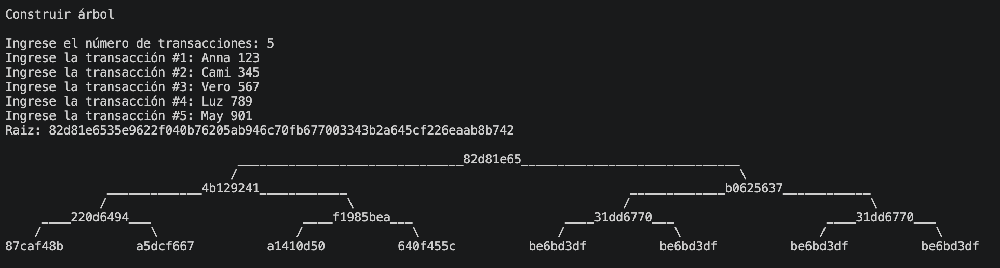
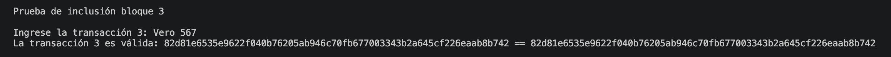
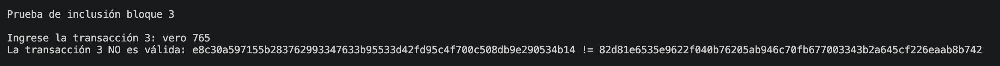
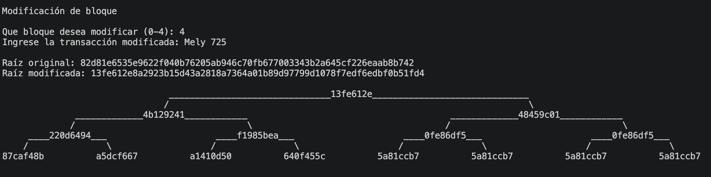

# Laboratorio 2 — Árbol de Merkle

Implementación de un Árbol de Merkle en Python, utilizado para verificar de forma eficiente la integridad de un conjunto de datos (transacciones) mediante hashes SHA-256.

## Descripción

Un Árbol de Merkle es una estructura de datos en forma de árbol binario donde:

- Cada **hoja** contiene el hash SHA-256 de un bloque de datos (transacción).
- Cada **nodo interno** contiene el hash SHA-256 de la concatenación de los hashes de sus dos hijos.
- Si el número de hojas en un nivel es **impar**, la última hoja se duplica para poder formar parejas.
- La **raíz (Merkle Root)** es el hash final que representa la integridad de todo el conjunto de datos: si cualquier transacción cambia, la raíz cambia.

## Requisitos

- Python 3.10 o superior (se usa `match`/`case` en el menú).
- Librería [`binarytree`](https://pypi.org/project/binarytree/) para la visualización gráfica del árbol.

## Ejecución

El programa solicitará el número de transacciones a ingresar, construirá el árbol y mostrará la raíz. Luego se despliega un menú con las siguientes opciones:

1. **Modificar un bloque**: cambia el contenido de una transacción, reconstruye el árbol y compara la raíz original con la modificada, evidenciando el cambio.
2. **Prueba de inclusión para el bloque 3**: solicita el valor de la transacción del bloque 3, busca los nodos hermanos necesarios en el árbol y reconstruye la raíz a partir de ellos. Si el valor ingresado coincide con el original, la verificación es válida; si se ingresa un dato incorrecto, la reconstrucción produce una raíz distinta y la verificación falla.
3. **Salir** del programa.

## Experimento realizado

1. Se crearon 5 bloques de datos (transacciones simuladas).
2. Se construyó el árbol de Merkle y se mostró la raíz resultante junto con la representación gráfica del árbol.
3. Se modificó el bloque 3 y se comprobó que la raíz del árbol cambia completamente respecto a la original.
4. Se generó la prueba de inclusión para el bloque 3, ingresando el valor correcto de la transacción, y se verificó que la raíz reconstruida coincide con la raíz original (verificación **válida**).
5. Se repitió la prueba de inclusión ingresando un dato incorrecto para el bloque 3, comprobando que la raíz reconstruida **no coincide** con la original (verificación **inválida**).

### Evidencias

- Diagrama del árbol construido.

- Captura de la verificación **válida** (bloque 3 correcto).

- Captura de la verificación **inválida** (dato incorrecto).

- Captura de la modificación de algún bloque.

## Estructura del código

| Función | Descripción |
|---|---|
| `Node` | Clase que representa un nodo del árbol de Merkle (valor, hijo izquierdo, hijo derecho). |
| `transacciones(n)` | Solicita al usuario `n` transacciones y devuelve la lista de sus hashes SHA-256. |
| `construir_nivel(nodos)` | Construye un nivel superior del árbol a partir de los nodos del nivel actual, duplicando el último si el número de nodos es impar. |
| `arbol(hashes)` | Construye el árbol completo a partir de los hashes de las hojas hasta obtener la raíz. |
| `modificar_bloque(hojas, raiz)` | Modifica una transacción existente, reconstruye el árbol y compara la raíz original con la nueva. |
| `convertir_a_binario(nodo, longitud_hash)` | Convierte recursivamente el árbol de Merkle a la estructura de `binarytree` para su visualización. |
| `imprimir_arbol(nodo)` | Muestra gráficamente el árbol de Merkle en consola. |
| `prueba_inclusion(nodo)` | Genera y verifica la prueba de inclusión para la transacción del bloque 3. |
| `buscar_hermanos(nodo, bloque, prueba)` | Recorre recursivamente el árbol buscando los nodos hermanos necesarios para reconstruir la raíz desde una hoja. |
| `menu()` | Controla el flujo principal del programa y despliega las opciones del experimento. |

**Funciones realizadas por mí:**

- `Node`
- `transacciones()`
- `modificar_bloque()`
- `imprimir_arbol()`
- `menu()`

**Funciones realizadas con ayuda de IA:**

- `construir_nivel()`
- `arbol()`
- `convertir_a_binario()`
- `prueba_inclusion()`
- `buscar_hermanos()`